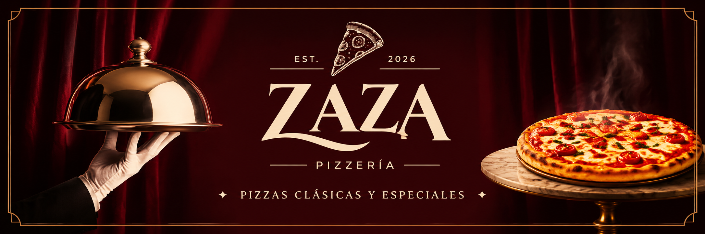

<p align="center">
  
</p>

Sitio web preview e informativo para **ZAZA**, pizzería delivery artesanal ubicada en Rosario, Colonia, Uruguay.

Este proyecto tiene como objetivo presentar la identidad de la marca, su propuesta gastronómica y habilitar el canal directo de pedidos y consultas a través de WhatsApp y redes sociales. No es un e-commerce transaccional con pasarela de pagos ni procesamiento automatizado de pedidos, sino una web de presentación y conversión directa.

---

## 🍕 Propuesta del Proyecto

- **Negocio:** ZAZA - Pizzería Delivery
- **Propuesta de valor:** Masa artesanal/casera, cultura pizzera mixta, ingredientes seleccionados y estilo visual nostálgico/elegante (años 70s/80s/90s).
- **Tipo de proyecto:** Web preview / Landing page informativa de alta calidad visual.
- **Canal principal de pedidos:** WhatsApp directo (+598 91 214 087).

---

## 🛠️ Stack Tecnológico

- **Framework:** [Astro](https://astro.build/) (Arquitectura basada en componentes, zero-JS por defecto)
- **Lenguaje:** TypeScript
- **Estilos:** Tailwind CSS
- **Iconografía:** Lucide (`lucide-astro`)
- **Tipografía y recursos visuales:** Fuentes locales con licencia OFL e imágenes optimizadas
- **Control de versiones:** Git & GitHub
- **Despliegue objetivo:** Vercel o Netlify

---

## 📂 Estructura del Repositorio

```text
zaza-pizzeria-page/
├── Assets/                 # Recursos gráficos originales (logos, fondos, fotos de menú)
│   ├── Backgrounds/
│   ├── Logos/
│   ├── Menu/
│   ├── Pngs/               # Elementos transparentes para composiciones interactivas
│   └── Presentation/
├── docs/                   # Documentación técnica, de negocio y guías de desarrollo
│   ├── AGENTS.md           # Instrucciones operativas para agentes de IA
│   ├── BUSINESS-INFO.md    # Ficha original de relevamiento del comercio
│   ├── CONTENT-GUIDELINES.md # Pautas de redacción, voz de marca y manejo de datos
│   ├── DEPLOYMENT.md       # Procedimientos de despliegue en Vercel/Netlify
│   ├── DESIGN.md           # Manual de identidad visual temática y escenográfica
│   ├── DESIGN-SYSTEM.md    # Identidad visual, paleta cromática y lineamientos UI
│   ├── DEVELOPMENT-RULES.md # Reglas de nombramiento, estructura de src/ y workflow
│   ├── ITERATION-PLAN.md   # Plan de ejecución secuencial e iteraciones técnicas
│   ├── OVERVIEW.md         # Resumen general del proyecto
│   ├── PROJECT-SCOPE.md    # Alcance funcional, requerimientos y exclusiones
│   ├── ROADMAP.md          # Estado actual y plan de evolución por fases
│   ├── SEO-AND-PERFORMANCE.md # Estrategia SEO, optimización web y Core Web Vitals
│   └── TECH-STACK.md       # Decisiones técnicas y arquitectura frontend
├── AGENTS.md               # Instrucciones de IA en raíz para herramientas
├── CHANGELOG.md            # Registro histórico de versiones y cambios notables
├── prettier.config.mjs     # Formato reproducible para Astro, TypeScript y CSS
├── LICENSE
└── README.md
```

## Estado de implementación

Portada rediseñada y catálogo completo implementado. Los originales de `Assets/` se importan mediante `astro:assets` y se generan variantes WebP.

- `src/components/`: LoadingScreen, Navbar, Wordmark, Hero, MenuSection, TVSection, PizzaCard, DeliveryInfo, ServiceHours, WhatsAppButton y Footer; `FeaturedDishes` y `PizzaShowcase` quedan conservados pero inactivos.
- `src/data/`: carta tipada y datos de negocio; enlaces WhatsApp con mensaje.
- `src/pages/index.astro`: composición de la landing.
- `src/layouts/Layout.astro`: metadatos y estructura HTML.
- `src/styles/global.css`: tokens Tailwind y estilos compartidos.
- `src/styles/fonts.css` y `public/fonts/`: fuentes locales WOFF2 y licencias.
- `src/utils/schedule.ts`: horario de Uruguay, incluyendo cierre después de medianoche.

Ver [plan de iteraciones](docs/ITERATION-PLAN.md) para pendientes de validación y publicación.

---

## 🚀 Requisitos e Instalación

### Prerrequisitos

- **Node.js:** Versión `>= 22.23.4`
- **Gestor de paquetes:** `npm` (o `pnpm` / `bun`)
- **Git**

### Comandos de Desarrollo (Proyecto Astro estándar)

Desde la raíz del repositorio:

```bash
# Instalar dependencias
npm install

# Iniciar servidor de desarrollo local
npm run dev

# Validar tipos
npm run check

# Validar formato, tipos y build en una sola ejecución
npm run validate

# Generar compilación de producción
npm run build

# Previsualizar la compilación de producción localmente
npm run preview
```

Antes del despliegue, copiar `.env.example` como variable de entorno del proveedor y reemplazar `PUBLIC_SITE_URL` por la URL real asignada.

---

## 📚 Índice de Documentación

Toda la documentación detallada se encuentra centralizada en la carpeta [`docs/`](docs/) y en la raíz:

1. **Visión y Alcance:**
   - [docs/OVERVIEW.md](docs/OVERVIEW.md) — Visión ejecutiva y resumen del emprendimiento.
   - [docs/PROJECT-SCOPE.md](docs/PROJECT-SCOPE.md) — Requerimientos funcionales, no funcionales y exclusiones explícitas.
   - [docs/BUSINESS-INFO.md](docs/BUSINESS-INFO.md) — Ficha de relevamiento comercial y datos de contacto.
2. **Diseño y Contenido:**
   - [docs/DESIGN.md](docs/DESIGN.md) — Manual integral de concepto escenográfico y publicitario vintage.
   - [docs/DESIGN-SYSTEM.md](docs/DESIGN-SYSTEM.md) — Paleta (Borgoña/Crema), tipografías, componentes y accesibilidad.
   - [docs/CONTENT-GUIDELINES.md](docs/CONTENT-GUIDELINES.md) — Tono de voz, catálogo oficial con precios y tratamiento de assets.
3. **Ingeniería, Estándares y Operaciones:**
   - [docs/TECH-STACK.md](docs/TECH-STACK.md) — Stack técnico, dependencias y arquitectura del código.
   - [docs/DEVELOPMENT-RULES.md](docs/DEVELOPMENT-RULES.md) — Convenciones de nombres, estructura interna y control de calidad.
   - [docs/ITERATION-PLAN.md](docs/ITERATION-PLAN.md) — Plan de construcción por iteraciones y criterios de salida (DoD).
   - [docs/SEO-AND-PERFORMANCE.md](docs/SEO-AND-PERFORMANCE.md) — Metadatos, marcado semántico, compresión y rendimiento.
   - [docs/DEPLOYMENT.md](docs/DEPLOYMENT.md) — Guía de despliegue en Vercel/Netlify y checklist pre-lanzamiento.
   - [docs/ROADMAP.md](docs/ROADMAP.md) — Cronograma de hitos: desde la documentación hasta el preview y mejoras futuras.
4. **Gobierno y Agentes:**
   - [AGENTS.md](AGENTS.md) — Reglas y directrices para agentes de IA que colaboren en el repositorio.
   - [CHANGELOG.md](CHANGELOG.md) — Registro de cambios y versiones del proyecto.

---

## 📄 Licencia

Este proyecto está bajo la Licencia MIT. Consulta el archivo [LICENSE](LICENSE) para más detalles.

## Hero interactivo sobre mesa (archivado)

El componente descrito a continuación ahora se guarda como `src/components/PizzaShowcase.astro` y no se monta en la portada.

`src/components/Hero.astro` reemplaza la portada anterior por la escena `Assets/hero-para-pngs.png`, la bandeja transparente de `Assets/Pngs/bandejas/` y cuatro pizzas de `Assets/Pngs/pizzas/`. La tapa y el plato se separan visualmente con CSS sobre el mismo PNG, sin alterar originales. Carrusel manual con botones, teclado y apertura por hover o toque; sin reproducción automática. La pizza nunca se ve desaparecer: al cerrar la tapa, la capa se oculta recién cuando el domo aterrice (700ms, cubierta físicamente), y el cambio con la tapa abierta cierra primero, intercambia detrás del domo y vuelve a abrir revelando la pizza nueva (el ocultado diferido se desactiva con movimiento reducido).

## Toldo festoneado en la barra de navegación (implementación anterior)

La imagen original `Assets/Backgrounds/header-bg.png` (1920×1072, tela superior + festón en la porción con contenido) permanece intacta como material de diseño. El fondo vivo de la navbar usa el derivado `Assets/Backgrounds/header-toldo.png` (recorte del bloque con contenido, 1920×395) estirado a llenar la barra exacta (`background-size: 100% 100%`, una sola imagen, sin mosaico: el pliegado no es periódico y el `repeat-x` generaba costuras; `cover` anclado abajo recortaba los pliegues y dejaba solo el festón). En ≤973px la barra es proporcional (20.57vw) y el estirado es nulo; por encima se estira elásticamente. Los huecos del festón son transparencias reales (sin respaldo ni color sólido en desktop): el hero sube con `margin-top: calc(-1 * min(200px, 20.57vw))` en ≥768px para pasar por detrás de la barra sticky, de modo que el telón se ve continuo a través de los agujeros y el contenido scrolleado pasa genuinamente detrás. El título del hero se ancla bajo la barra con la misma fórmula (`padding-top` en flujo 768–849px; `top` absoluto ≥850px). La barra va sin sombra de bloque (una sombra rectangular pintaría el borde duro bajo el festón que "clava" la transparencia) y la marca ZAZA vive estampada sobre la tela en ≥768px (más grande y arriba a la izquierda, con sangrado de tinta y sombra de contacto sobre el paño). El teléfono flotante de WhatsApp (`WhatsAppButton.astro`) cuelga del borde inferior del toldo con `z-index: 30` (por debajo del header z-40) y compensa los 57px nativos de padding sobre su cordón (`top: calc(min(12.5rem, 20.57vw) - 32px)`): el tramo inicial del cordón queda tapado por el festón y emerge de su borde.

## Portada con fachada y pizarrón

`Hero.astro` muestra la fachada representativa (`Assets/hero-section-reworked.jpeg`) y el pizarrón enlaza a `#menu`, donde hay una ruta Inicio / Carta. Las variantes normales y iluminadas del pizarrón se conservan en `Assets/Pizarron hero/`; las copias `-recortado.png` eliminan solo el margen transparente para la composición. La fachada es ilustrativa: el horario visible en la imagen no corresponde al confirmado en [BUSINESS-INFO.md](docs/BUSINESS-INFO.md); la web comunica 20:00 a 01:00 y solo delivery. La escena anterior de pizzas y campana permanece íntegra en `src/components/PizzaShowcase.astro`, sin importarse en la página por ahora. Los platillos destacados están separados en `src/components/FeaturedDishes.astro` y tampoco se montan; el menú mantiene la carta oficial.

## Header vigente

`Navbar.astro` utiliza `Assets/header-reworked-zaza.png` (3840×790): el logotipo ya está impreso en el toldo, por lo que no se superpone `Wordmark`. Una zona enlazada accesible permite volver al inicio haciendo clic sobre la marca. No hay enlaces de sección en el header; el botón «Hacer pedido» conserva su posición en escritorio y el teléfono colgante da acceso a pedidos en móvil. El festón mantiene transparencia real y el hero pasa por detrás en escritorio y móvil.

`Layout.astro` desactiva la restauración automática de scroll solamente durante una recarga: la página vuelve al comienzo antes de abrir los telones. Los enlaces ancla siguen funcionando durante la navegación normal.

## TV Section

`src/components/TVSection.astro` ocupa el lugar del antiguo bloque «Nuestra masa» entre la carta y el delivery. Superpone `Assets/TV Section/tv/TV.png` sobre `tv-section-base.jpeg`, alineando el televisor con la mesa; en móvil se muestra el sector izquierdo de la sala para mantener la TV visible. Al pasar el mouse, cuatro frames de `Assets/TV Section/tv/tv-estatica-*.png` reproducen estática en bucle; en pantallas táctiles un toque enciende y otro apaga. Movimiento reducido muestra un frame fijo. La sección conserva el ancla `#tv`. La imagen de referencia `Assets/Presentation/tv-70s-all-section.jpeg` no se publica: incluye una promoción no confirmada.

## Apertura de telones

`src/components/LoadingScreen.astro` utiliza los dos lienzos transparentes de `Assets/Loading screen/` como mitades acopladas a pantalla completa. La pizza central gira mientras cargan los recursos de portada, sube rápidamente y los telones se abren hacia los lados. La capa se retira al terminar, con tiempo máximo de seguridad; sin JavaScript o con movimiento reducido no bloquea el sitio. Los PNG originales se optimizan con `astro:assets`.
